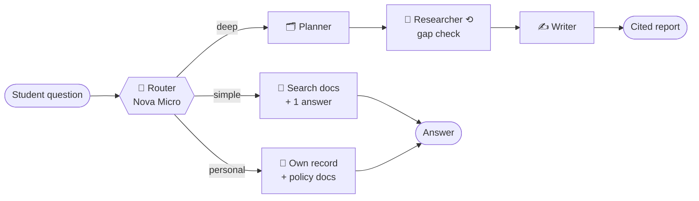
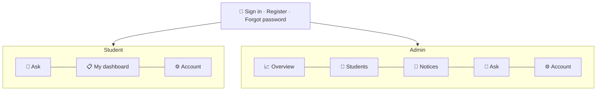

<div align="center">

# 🎓 Smart Campus Assistant

**An AI student helpdesk that answers cheaply when it can and thinks deeply only when it must.**

Students sign in and ask about exams, fees, hostel, library and placements, or about their *own* fee status, books, attendance and exams. Admins get a portal with college-wide overviews and notices.


</div>

> [!NOTE]
> **XYZ College of Engineering is fictional.** Every college document, student, email address and amount in this repo is synthetic.

---

## ✨ Highlights

| | |
|---|---|
| 🧭 **Cost-aware routing** | A small model (Nova Micro) picks the lightest path: `simple`, `personal` or `deep`. |
| 👤 **Personal answers, private by design** | The `personal` path reads only the signed-in student's record. Guests get a sign-in prompt, and questions about other students are refused. |
| 🔎 **Deep research with citations** | Comparisons and multi-step questions go to a planner → researcher loop → writer, which produces a cited report. |
| 🔐 **Real accounts** | Self-registration, email + password sign-in, PBKDF2 hashes in SQLite, login throttling, sessions that survive a refresh, and password reset. |
| 🧑‍💼 **Admin portal** | College-wide fees, library and attendance overview, a student directory, password resets and live notices. |
| 📢 **Live notices** | A notice the admin publishes is indexed into the vector store at once, so the assistant can answer about it immediately. |
| 🧪 **Measured, not guessed** | A 45-question eval compares the router against an "always deep" baseline. |

## 📊 Results (live eval, 45 questions)

| Metric | Router | Always deep |
|---|---:|---:|
| Route accuracy | **97.8 %** | – |
| Total cost | **$0.0136** | $0.0343 |
| Avg latency | **7.4 s** | 18.4 s |
| Answer keyword hit | 0.87 | 0.89 |

**60 % cheaper and about 2.5× faster at the same answer quality.** Simple answers average about 2.9 s, personal answers about 2.8 s and deep reports about 18.6 s.

---

## 🧠 How a question is answered



| Route | When | LLM calls |
|---|---|---|
| `simple` | One fact about the college ("What is the library fine per day?") | 2 |
| `personal` | The student's own data ("Meri fees ka status kya hai?") | 2 (1 for guests) |
| `deep` | Comparisons and planning ("Compare CSE and ECE placements") | ~10 |

Every LLM call records tokens, latency and USD cost for the eval. The UI does not show these numbers.

## 🖥️ What each role sees



- **Student → My dashboard:** fees due with the late fee so far, payment receipts, issued books with fines, attendance per course (75 % line), CGPA, upcoming exams, hostel and latest notices.
- **Admin → Overview:** fees collected and outstanding, overdue accounts, overdue books, low attendance, backlogs, and an "action needed" list.
- **Admin → Students:** search and filters, the full profile of any student, and a password reset that issues a one-time temporary password.

## 🔐 Accounts and security

- **Register:** a *new admission* signs up with any email, picks a branch and category, and gets a new Student ID with a first-year record. An *existing student* claims their account with their Student ID and college email.
- **Passwords:** PBKDF2-HMAC-SHA256 (600k iterations, per-user salt), stored in SQLite (`data/app.db`, git-ignored). Rules: at least 8 characters, with a letter and a digit.
- **Login protection:** a generic "invalid email or password" message, timing-safe checks for unknown emails, and a 60 s lockout after 5 failures.
- **Sessions:** a random token in a `SameSite=Strict` cookie. Only its hash is stored on the server. It expires after 12 h, and logging out or changing the password revokes it.
- **Forgot password:** a 6-digit code with a 15-minute expiry and at most 5 attempts. It is sent by email when SMTP is configured. In demo mode (no SMTP) the code is shown on screen.
- **Privacy:** only the signed-in student's record ever reaches a prompt.

---

## 🧰 Tech stack

| Layer | Choice |
|---|---|
| Orchestration | LangGraph |
| LLMs | Amazon Nova Micro (router), Nova Lite (answers) on AWS Bedrock |
| Embeddings | Amazon Titan Text Embeddings v2 |
| Vector store | Amazon S3 Vectors via `langchain_aws.AmazonS3Vectors` |
| App | Streamlit (role-based pages, Altair charts) |
| Accounts | SQLite + standard-library crypto (no extra auth packages) |
| Data | Markdown docs in `data/college/`, student records in `data/students.json`, notices in `data/notices.json` |

## 🚀 Quick start

```bash
python -m venv .venv
.venv\Scripts\activate             # macOS/Linux: source .venv/bin/activate
pip install -r requirements-dev.txt
pip install -e .
cp .env.example .env               # AWS region, models, optional SMTP
python -m smart_campus_assistant.auth seed-demo   # demo accounts → data/demo_credentials.csv
```

**Offline (no AWS, fake LLM):**
```bash
SCA_DEMO_MODE=1 streamlit run app.py
```

**With AWS:** create an S3 vector bucket (us-east-1) named as in `VECTOR_BUCKET_NAME`, enable Bedrock access for Nova Micro, Nova Lite and Titan Embeddings v2, then:
```bash
python -m smart_campus_assistant.ingest   # index docs + notices (--dry-run to just count)
streamlit run app.py
```

> [!TIP]
> Demo sign-ins are listed in `data/demo_credentials.csv` (git-ignored). You can also register your own student account from the sign-in page.

## ☁️ Free public demo (Streamlit Community Cloud)

1. Fork or push this repo to GitHub.
2. On [share.streamlit.io](https://share.streamlit.io) choose the repo, branch `main`, main file `app.py` and Python 3.11.
3. In **Advanced settings → Secrets**, add:
   ```toml
   SCA_DEMO_MODE = "1"
   SCA_DEMO_PASSWORD = "campus-demo-2026"
   ```
   On first start the app creates every demo account with that password, which must be at least 8 characters and contain a letter and a digit. Demo mode uses a fake LLM, so it needs no AWS keys and costs nothing.

> [!WARNING]
> The free host's disk is temporary. Registrations, sessions, chats and new notices reset when the app restarts.

## 🧪 Evaluation and tests

```bash
python eval/run_eval.py          # live: router vs always-deep (route accuracy, tokens, cost, latency)
python eval/run_eval.py --fake   # offline dry run
python -m pytest -q              # offline test suite (fake LLM, fake retriever, temp SQLite)
```

## 🗂️ Project layout

```
app.py                         sign-in gate + role-based navigation
ui/                            login, chat, student dashboard, admin pages, account, theme
src/smart_campus_assistant/
  graph.py  router.py          LangGraph wiring and 3-way router
  simple_rag.py  personal.py   simple and personal paths
  deep_research.py  prompts.py planner → researcher → writer
  retriever.py  ingest.py      S3 Vectors search and indexing
  auth.py  db.py  mailer.py    accounts, sessions, reset codes (SQLite)
  student_data.py  notices.py  student records, admin notices
  usage.py                     token and cost tracking (eval only)
eval/                          45 labelled questions + runner
data/college/                  synthetic college documents
tests/                         offline tests
```

## 🛣️ Roadmap

- [ ] Compute totals (fees, yearly cost) in code instead of in the LLM
- [ ] Heading-level chunking for long rules (e.g. degree classification)
- [ ] Email verification on registration
- [ ] Persistent storage (Postgres) for the hosted demo

<div align="center">

Built with LangGraph · AWS Bedrock · Amazon S3 Vectors · Streamlit

</div>
