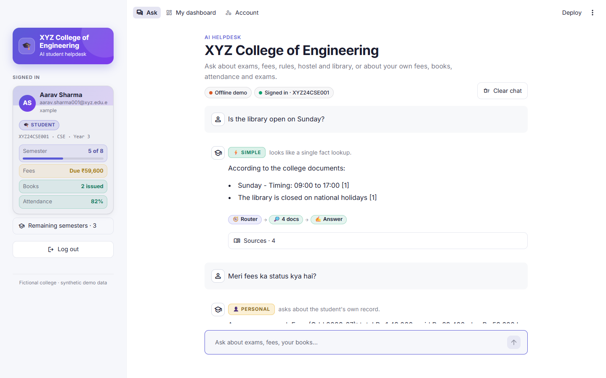
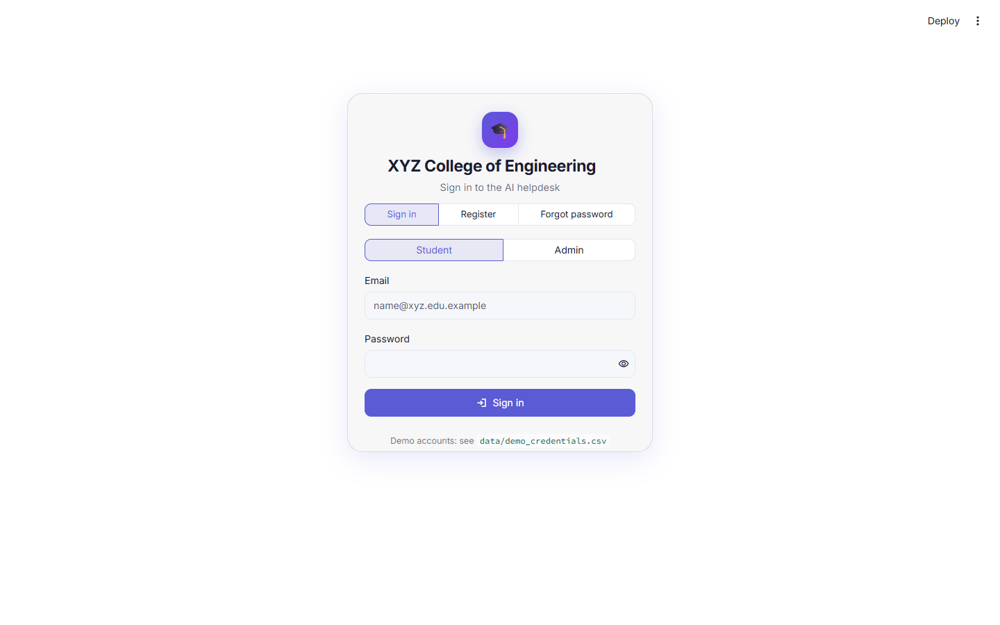
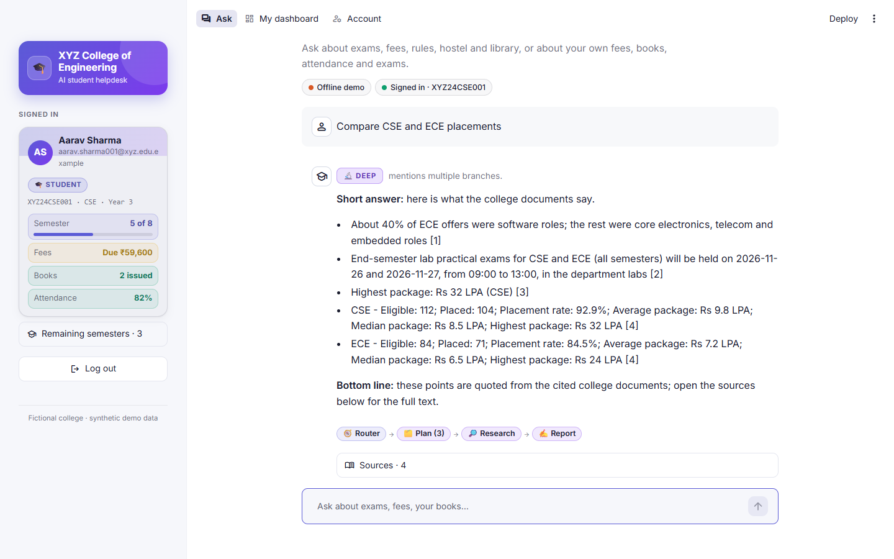
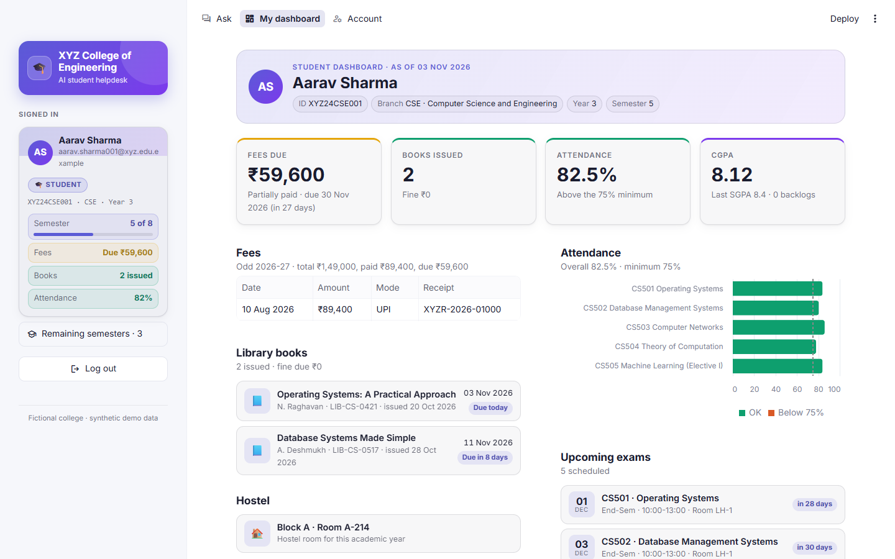
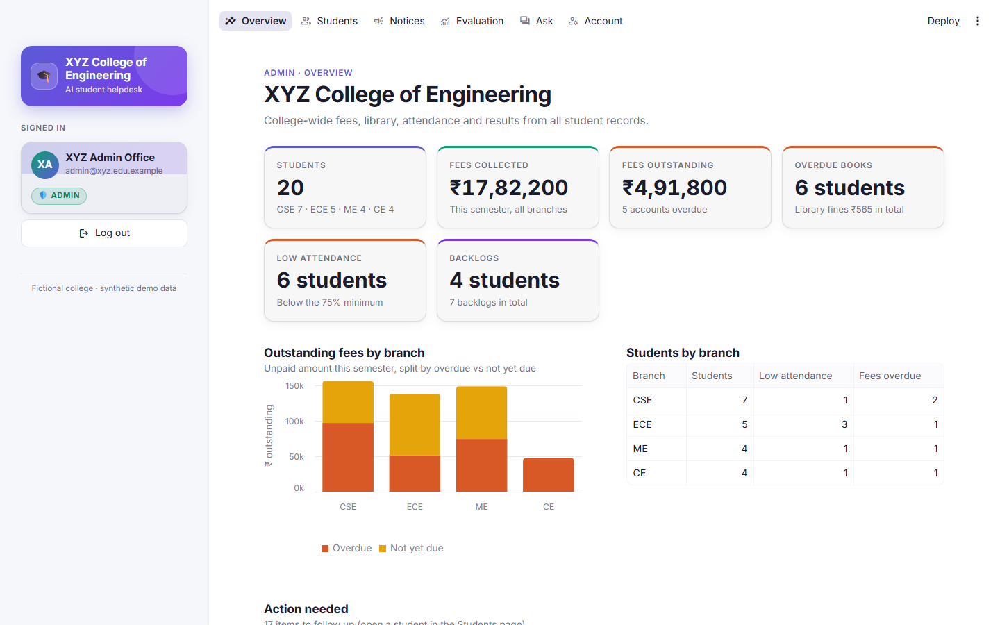
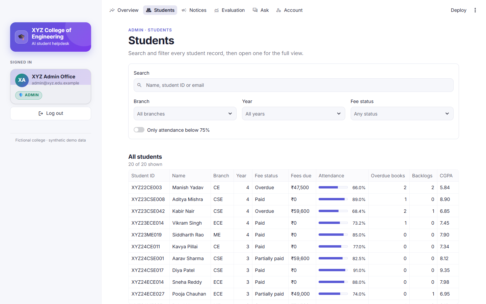
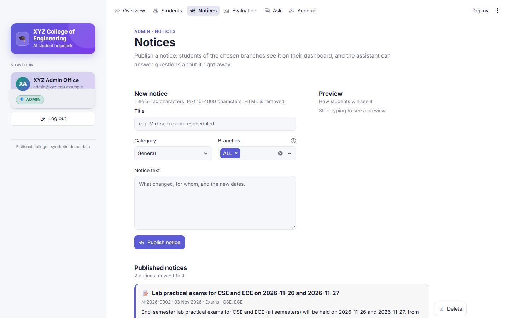
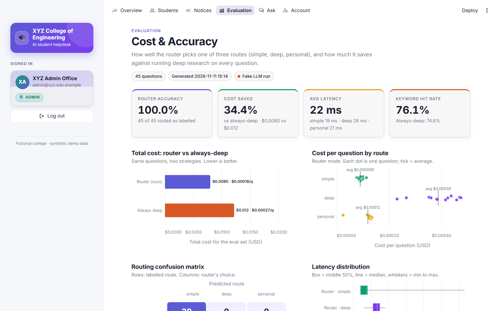
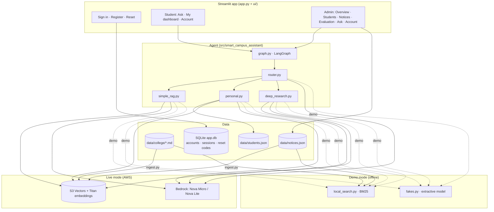
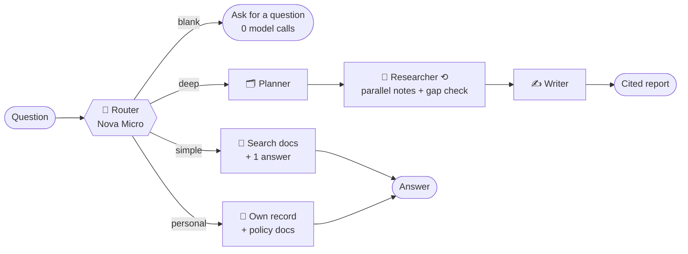

<div align="center">

# 🎓 Smart Campus Assistant

**An AI student helpdesk that answers cheaply when it can and thinks deeply only when it must.**

Students sign in and ask about exams, fees, hostel, library and placements, or about their *own* fee status, books, attendance and exams. Admins get a portal with college-wide overviews, notices and an evaluation dashboard.

[](https://github.com/musaddiq-vd/smart-campus-assistant/actions/workflows/ci.yml)




</div>

> [!NOTE]
> **XYZ College of Engineering is fictional.** Every college document, student, email address and amount in this repo is synthetic.

## Contents

- [Highlights](#-highlights)
- [Screenshots](#-screenshots)
- [Architecture](#-architecture)
- [How a question is answered](#-how-a-question-is-answered)
- [Results](#-results-live-eval-45-questions)
- [Accounts and security](#-accounts-and-security)
- [Quick start](#-quick-start)
- [Configuration](#-configuration)
- [Evaluation and tests](#-evaluation-and-tests)
- [Project layout](#-project-layout)
- [Roadmap](#-roadmap)

---

## ✨ Highlights

| | |
|---|---|
| 🧭 **Cost-aware routing** | A small model (Nova Micro) picks the lightest path: `simple`, `personal` or `deep`. If it fails, a keyword router takes over. |
| 👤 **Personal answers, private by design** | The `personal` path reads only the signed-in student's record. Guests get a sign-in prompt, and questions about other students are refused before the answer model sees anything. |
| 🔎 **Deep research with citations** | Comparisons and multi-step questions go to a planner → researcher loop → writer. Sub-questions are researched in parallel and the report cites its sources. |
| 🔐 **Real accounts** | Self-registration, email + password sign-in, PBKDF2 hashes in SQLite, login throttling, sessions that survive a refresh, and password reset. |
| 🧑‍💼 **Admin portal** | College-wide fees, library and attendance overview, a student directory, password resets, live notices and an evaluation page. |
| 📢 **Live notices** | A notice the admin publishes is searchable at once, so the assistant can answer about it immediately. |
| 📴 **Works offline** | Demo mode needs no AWS: a keyword (BM25) search over the same documents and an extractive stand-in model, so answers still quote the real data. |
| 🧪 **Measured, not guessed** | A 45-question eval compares the router against an "always deep" baseline; 320 offline tests cover the rest. |

## 📸 Screenshots

All screenshots are from demo mode (offline, synthetic data).

| Sign in · Register · Forgot password | Deep research with a cited report |
|---|---|
|  |  |

| Student dashboard | Admin overview |
|---|---|
|  |  |

| Admin · students | Admin · notices |
|---|---|
|  |  |

| Admin · evaluation (offline run shown) |
|---|
|  |

---

## 🏗️ Architecture



**Two interchangeable backends.** In live mode every search goes to Amazon S3 Vectors and every model call to Bedrock. In demo mode `fakes.enable_fake_mode()` swaps both for offline versions that read the *same* documents, so the UI, the graph and the tests run unchanged without credentials. Demo mode is automatic when no AWS credentials are found, or forced with `SCA_DEMO_MODE=1`.

## 🧠 How a question is answered



| Route | When | LLM calls |
|---|---|---|
| `simple` | One fact about the college ("What is the library fine per day?") | 2 |
| `personal` | The student's own data ("Meri fees ka status kya hai?") | 2 (1 for guests) |
| `deep` | Comparisons and planning ("Compare CSE and ECE placements") | ~10 |

Details worth knowing:

- **Bounded cost.** Questions are trimmed to 2,000 characters, blank ones are answered without a model call, and the deep path is capped at 6 sub-questions and 2 extra research loops.
- **Money and dates are computed in code.** Late fees, library fines and "days left" are worked out by `student_data.py` and handed to the model as facts, so it never does date math.
- **Privacy check before the model.** `personal.py` refuses questions that name another student (ID, name, "my friend's fees"). Pronouns that usually mean a *thing* ("the hostel rules and their fees", "exam kab hai aur uski fees") are not mistaken for a person.
- **Parallel research.** The sub-questions of one loop run on `RESEARCH_WORKERS` threads and are merged back in plan order, so the report is the same as a sequential run.
- Every LLM call records tokens, latency and USD cost. Students never see these numbers; admins see them on the Evaluation page.

## 📊 Results (live eval, 45 questions)

| Metric | Router | Always deep |
|---|---:|---:|
| Route accuracy | **97.8 %** | – |
| Total cost | **$0.0136** | $0.0343 |
| Avg latency | **7.4 s** | 18.4 s |
| Answer keyword hit | 0.87 | 0.89 |

**60 % cheaper and about 2.5× faster at the same answer quality.** Simple answers average about 2.9 s, personal answers about 2.8 s and deep reports about 18.6 s.

> [!NOTE]
> These numbers are from a live Bedrock run made before parallel research was added, so deep latency should now be somewhat lower; re-run `python eval/run_eval.py` to refresh them. The Evaluation screenshot above shows an *offline* run (`--fake`), whose latency and accuracy describe the stand-in model, not Bedrock.

---

## 🖥️ What each role sees

- **Student → Ask:** chat with a route badge, the steps that ran and expandable sources. History survives a refresh; an interrupted answer offers a retry.
- **Student → My dashboard:** fees due, payment receipts, issued books with due dates, attendance per course (75 % line), CGPA, upcoming exams, hostel and the latest notices for their branch.
- **Admin → Overview:** fees collected and outstanding, overdue accounts, overdue books, low attendance, backlogs, and an "action needed" list.
- **Admin → Students:** search and filters, the full profile of any student, and a password reset that issues a one-time temporary password.
- **Admin → Notices:** publish (HTML is stripped) and delete notices; they appear on student dashboards and in search immediately.
- **Admin → Evaluation:** router accuracy, cost vs the always-deep baseline, confusion matrix, latency and a per-question table.

## 🔐 Accounts and security

- **Register:** a *new admission* signs up with any email, picks a branch and category, and gets a new Student ID with a first-year record. An *existing student* claims their account with their Student ID and college email.
- **Passwords:** PBKDF2-HMAC-SHA256 (600k iterations, per-user salt), stored in SQLite (`data/app.db`, git-ignored). Rules: at least 8 characters, with a letter and a digit.
- **Login protection:** a generic "invalid email or password" message, timing-safe checks for unknown emails, and a 60 s lockout after 5 failures.
- **Sessions:** a random token in a `SameSite=Strict` cookie. Only its hash is stored on the server. It expires after 12 h, and logging out or changing the password revokes it.
- **Forgot password:** a 6-digit code with a 15-minute expiry and at most 5 attempts. It is sent by email when SMTP is configured. In demo mode (no SMTP) the code is shown on screen.
- **Privacy:** only the signed-in student's record ever reaches a prompt.

---

## 🧰 Tech stack

| Layer | Choice |
|---|---|
| Orchestration | LangGraph |
| LLMs | Amazon Nova Micro (router), Nova Lite (answers) on AWS Bedrock |
| Embeddings | Amazon Titan Text Embeddings v2 |
| Vector store | Amazon S3 Vectors via `langchain_aws.AmazonS3Vectors` |
| Offline search | BM25 over the same chunks (`local_search.py`), no dependencies |
| App | Streamlit (role-based pages, Altair charts) |
| Accounts | SQLite + standard-library crypto (no extra auth packages) |
| Quality | pytest (320 offline tests), Ruff, GitHub Actions |

## 🚀 Quick start

```bash
python -m venv .venv
.venv\Scripts\activate             # macOS/Linux: source .venv/bin/activate
pip install -r requirements-dev.txt
pip install -e .
cp .env.example .env               # AWS region, models, optional SMTP
python -m smart_campus_assistant.auth seed-demo   # demo accounts → data/demo_credentials.csv
```

**Offline (no AWS, no cost):**
```bash
SCA_DEMO_MODE=1 streamlit run app.py
```
On Windows PowerShell: `$env:SCA_DEMO_MODE = "1"; streamlit run app.py`.

**With AWS:** create an S3 vector bucket (us-east-1) named as in `VECTOR_BUCKET_NAME`, enable Bedrock access for Nova Micro, Nova Lite and Titan Embeddings v2, then:
```bash
python -m smart_campus_assistant.ingest   # index docs + notices (--dry-run to just count)
streamlit run app.py
```

> [!TIP]
> Demo sign-ins are listed in `data/demo_credentials.csv` (git-ignored). You can also register your own student account from the sign-in page.

### ☁️ Free public demo (Streamlit Community Cloud)

1. Fork or push this repo to GitHub.
2. On [share.streamlit.io](https://share.streamlit.io) choose the repo, branch `main`, main file `app.py` and Python 3.11.
3. In **Advanced settings → Secrets**, add:
   ```toml
   SCA_DEMO_MODE = "1"
   SCA_DEMO_PASSWORD = "campus-demo-2026"
   ```
   On first start the app creates every demo account with that password, which must be at least 8 characters and contain a letter and a digit.

> [!WARNING]
> The free host's disk is temporary. Registrations, sessions, chats and new notices reset when the app restarts.

## ⚙️ Configuration

Everything is set through environment variables (or `.env`); all have defaults except the AWS credentials.

| Variable | Default | Purpose |
|---|---|---|
| `AWS_ACCESS_KEY_ID`, `AWS_SECRET_ACCESS_KEY`, `AWS_DEFAULT_REGION` | – / – / `us-east-1` | Bedrock and S3 Vectors access (live mode) |
| `VECTOR_BUCKET_NAME`, `VECTOR_INDEX_NAME` | `smart-campus-assistant-vectors`, `xyz-college-docs` | S3 Vectors bucket and index |
| `ROUTER_MODEL_ID`, `ANSWER_MODEL_ID`, `EMBEDDING_MODEL_ID` | Nova Micro, Nova Lite, Titan v2 | Bedrock models |
| `RETRIEVER_K` | `5` | Chunks retrieved per search |
| `MAX_RESEARCH_LOOPS` | `2` | Extra gap-check loops on the deep path |
| `RESEARCH_WORKERS` | `4` | Sub-questions researched at once (`1` = sequential) |
| `SCA_DEMO_MODE` | auto | `1` forces offline demo mode, `0` forces live |
| `SCA_DEMO_PASSWORD` | – | Hosted demos: create all demo accounts with this password on first start |
| `SCA_DB_FILE`, `SCA_NOTICES_FILE`, `SCA_CHATS_DIR` | under `data/` | Storage locations |
| `SMTP_HOST`, `SMTP_PORT`, `SMTP_USER`, `SMTP_PASSWORD`, `SMTP_FROM` | – | Email password reset codes (otherwise shown on screen in demo) |

## 🧪 Evaluation and tests

```bash
python eval/run_eval.py          # live: router vs always-deep (route accuracy, tokens, cost, latency)
python eval/run_eval.py --fake   # offline dry run (free, a few seconds)
python -m pytest -q              # 320 offline tests (fake LLM, offline search, temp SQLite)
ruff check .                     # lint
```

Either eval run fills the admin **Evaluation** page. The tests cover routing, the three answer paths, privacy refusals, late-fee and fine math, accounts and sessions, registration and password reset, notices, the Streamlit pages, and edge cases such as blank or oversized questions and concurrent research. GitHub Actions runs the tests and Ruff on every push and pull request.

## 🗂️ Project layout

```
app.py                         sign-in gate + role-based navigation
ui/                            Streamlit pages
  login.py  account.py  session.py     sign in, register, reset, cookies
  chat.py                              "Ask" page
  student_home.py                      student dashboard
  admin_overview.py  admin_students.py admin pages
  admin_notices.py  admin_evaluation.py
  components.py  theme.py              shared HTML builders and CSS
src/smart_campus_assistant/
  graph.py  router.py  state.py        LangGraph wiring, 3-way router, state
  simple_rag.py  personal.py           simple and personal paths
  deep_research.py  prompts.py         planner → researcher → writer
  retriever.py  ingest.py              S3 Vectors search and indexing
  local_search.py  fakes.py            offline BM25 search and stand-in model
  auth.py  db.py  mailer.py            accounts, sessions, reset codes (SQLite)
  student_data.py  notices.py          student records, admin notices
  chat_store.py  usage.py              chat history, token and cost tracking
eval/                          45 labelled questions + runner
data/college/                  synthetic college documents (see data/sources.md)
docs/screenshots/              images used in this README
tests/                         offline tests
.github/workflows/ci.yml       tests + lint on every push
```

## 🛣️ Roadmap

- [ ] Follow-up questions that use the earlier turns of the chat
- [ ] Compute totals (fees, yearly cost) in code instead of in the LLM
- [ ] Heading-level chunking for long rules (e.g. degree classification)
- [ ] Email verification on registration
- [ ] Persistent storage (Postgres) for the hosted demo

<div align="center">

Built with LangGraph · AWS Bedrock · Amazon S3 Vectors · Streamlit

</div>
