<div align="center">

# 🎓 Smart Campus Assistant

**An AI student helpdesk that answers cheaply when it can and thinks deeply only when it must.**

Students ask about the college or their *own* record, pay their fees and raise requests to the admin office. Admins run the office: they answer requests, update student records, publish notices and see which questions the documents could not answer.

[](https://github.com/musaddiq-vd/smart-campus-assistant/actions/workflows/ci.yml)


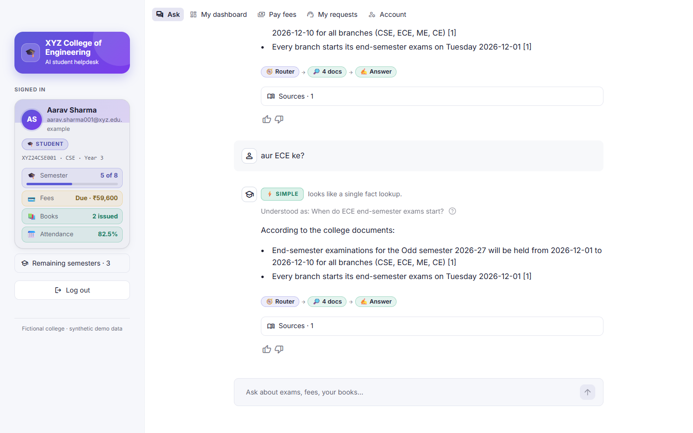

</div>

> [!NOTE]
> **XYZ College of Engineering is fictional.** Every college document, student, email address and amount in this repo is synthetic.

## Contents

- [Highlights](#-highlights)
- [What students and admins can do](#-what-students-and-admins-can-do)
- [Screenshots](#-screenshots)
- [Architecture](#-architecture)
- [How a question is answered](#-how-a-question-is-answered)
- [Accounts and security](#-accounts-and-security)
- [Quick start](#-quick-start)
- [Configuration](#-configuration)
- [Tests and model evaluation (developers)](#-tests-and-model-evaluation-developers)
- [Project layout](#-project-layout)
- [Roadmap](#-roadmap)

---

## ✨ Highlights

| | |
|---|---|
| 🧭 **Cost-aware routing** | A small model (Nova Micro) picks the lightest path: `simple`, `personal` or `deep`. If it fails, a keyword router takes over. |
| 👤 **Personal answers, private by design** | The `personal` path reads only the signed-in student's record. Questions about other students are refused before the answer model sees anything, and admins (who have no record) are pointed to the Students page. |
| 🔎 **Deep research with citations** | Comparisons and multi-step questions go to a planner → researcher loop → writer. Sub-questions are researched in parallel and the report cites its sources. |
| 🧲 **Hybrid search** | Vector search and BM25 keyword search are fused (reciprocal rank fusion) and reranked without an extra model call. Documents are chunked by heading, so a rule stays in one piece, and every source card shows the document and its section. |
| ✅ **Grounded answers** | Fee totals (per semester, per year, four years, after scholarships) are computed in code. Every `[n]` in an answer points to a real source; an answer without one becomes a clear "Information not available" with a pointer to the admin office. |
| 🔐 **Real accounts** | Self-registration with an emailed verification code, email + password sign-in, PBKDF2 hashes in SQLite, login throttling, sessions that survive a refresh, and password reset. One-time codes are never shown on screen outside demo mode. |
| 🧑‍💼 **Admin office in one place** | Overview, student records the admin can update (payments, books, attendance, hostel), a request queue, notices and helpdesk insights. Every record change is audit-logged. |
| 🎫 **Requests, not phone calls** | Students raise requests (certificates, fee issues, hostel, library, exams) and follow the replies; admins work a queue with statuses. |
| 💳 **Fee payment with receipts** | Students pay their dues in a simulated checkout (no card or bank details are ever asked for) and download receipts. |
| 📧 **Email notifications** | Students get an email when the admin replies to their request, when a notice for their branch is published, and fee reminders 7 days before the due date and weekly while overdue. Emails go through an outbox: none is queued twice, failed ones are retried (3 attempts) and the admin sees the status of each. |
| 📢 **Live notices** | A notice the admin publishes is searchable at once, so the assistant can answer about it immediately. |
| 📈 **Content gaps surfaced** | The Insights page lists the questions the documents could not answer, so the office knows which notice or document to add. No student identity is stored. |
| 👍 **Feedback and monitoring** | Students rate each answer (with an optional comment), and Insights shows the ratings next to model usage: latency (average and p95), tokens, cost and failed questions, for today and the last 14 days. |
| 📄 **Upload documents** | Admins upload .md, .txt or .pdf files (up to 2 MB) on the Documents page; the assistant can answer from them right away. |
| 💬 **Follow-up questions** | "aur ECE ka?" after a CSE fee question is understood from the earlier turns and answered as a full question. |
| 🛡️ **Abuse limits** | A per-account question budget keeps one account from running up the model bill. |
| 📴 **Works offline** | Demo mode needs no AWS: a keyword (BM25) search over the same documents and an extractive stand-in model, so answers still quote the real data. |
| 🧪 **Measured, not guessed** | A 45-question developer eval compares the router against an "always deep" baseline; 866 offline tests cover the rest. |

## 🧑‍🎓 What students and admins can do

| | Student | Admin |
|---|---|---|
| **Ask** | College questions *and* their own record (fees, books, attendance, exams, semesters), in English or Hinglish, with follow-ups; rate each answer 👍 / 👎 | College questions only; the chat never reads student records for admins |
| **Records** | **My dashboard**: fees, receipts, issued books, attendance per course, CGPA, exams, hostel, notices | **Students**: search and filter everyone, open a profile, then **Manage record**: record a payment, issue / return a book, update attendance, set the hostel room, see recent changes |
| **Fees** | **Pay fees**: see the due amount, late fee so far, pay in full or in part (simulated), download receipts; email reminders before the due date and while overdue | Record payments received at the accounts office; overview of collected vs outstanding fees; **Send fee reminders now** and the email outbox on the Overview |
| **Requests** | **My requests**: raise a request, follow the conversation, reply, close it; an email for every admin reply | **Requests**: queue with open / in progress / resolved counts, filters, reply (the student is emailed), change status |
| **Notices** | Latest notices for their branch on the dashboard and by email; the assistant answers about them | **Notices**: publish (HTML is stripped) and delete; searchable immediately; students of the chosen branches are emailed |
| **Documents** | – | **Documents**: upload .md / .txt / .pdf files the assistant answers from, delete them; the built-in documents are read-only |
| **Insights** | – | **Insights**: questions per day and topic, questions the documents could not answer, most asked questions, answer ratings and comments, model usage (latency, tokens, cost, failed questions), three CSV exports |
| **Account** | Register (new admission or claim an existing ID, confirmed with an emailed code), sign in, reset or change password | Reset a student's password to a one-time temporary password |

Rules the app enforces in the backend, not just the UI: a student can only read, pay or raise requests for their **own** record; every admin change to a record is written to an audit log with the admin's email; payments can never exceed what is due; an account is only created after the code sent to its email comes back.

## 📸 Screenshots

All screenshots are from demo mode (offline, synthetic data).

**Student**

| Sign in · Register · Forgot password | Deep research with a cited report |
|---|---|
| 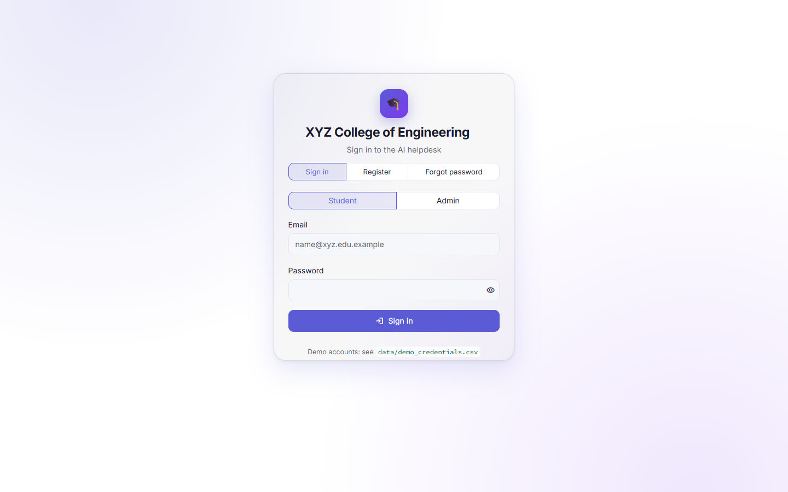 | 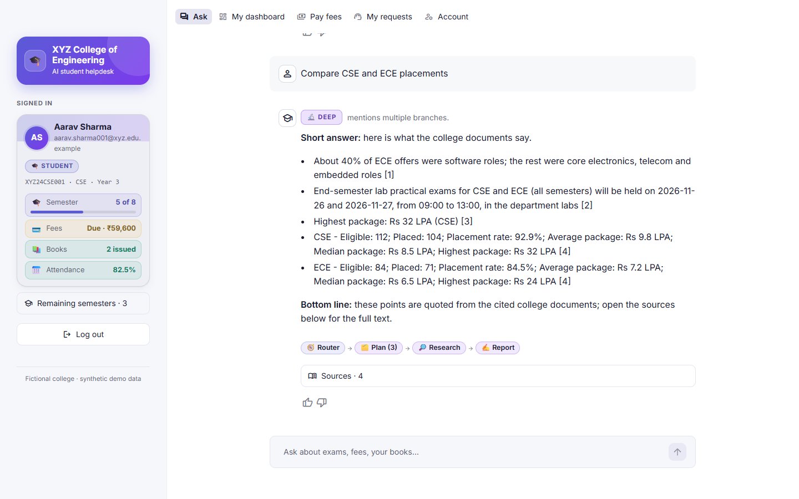 |

| My dashboard | Pay fees (simulated) |
|---|---|
| 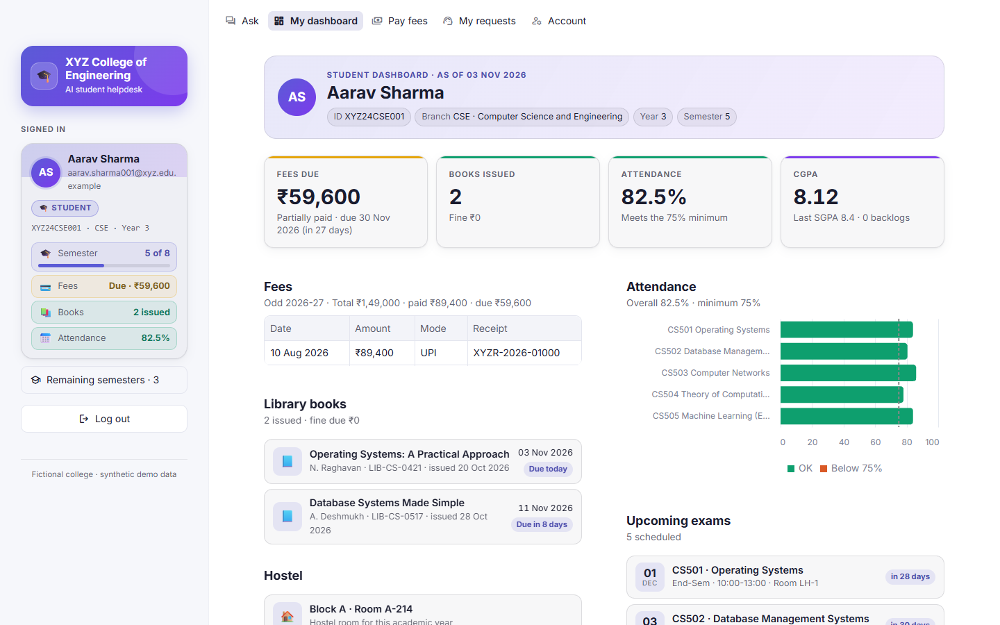 | 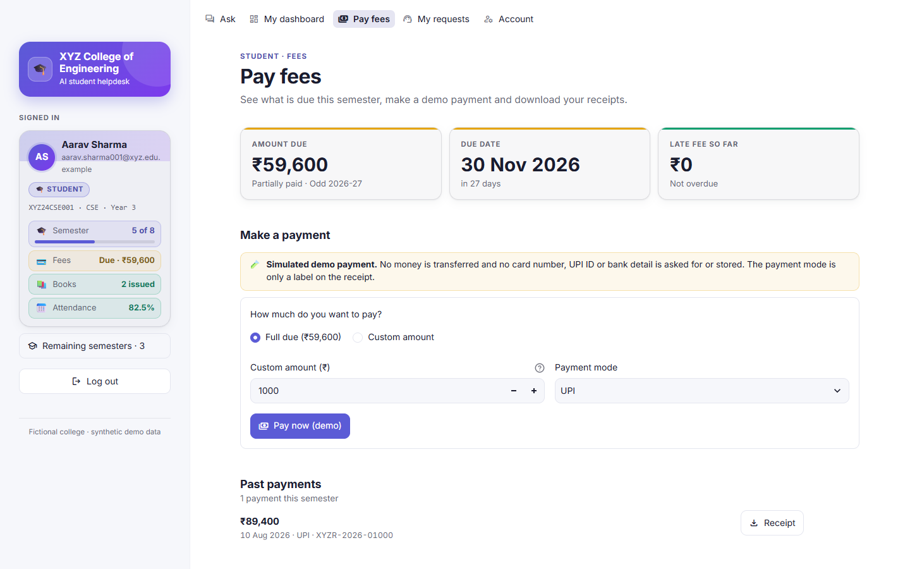 |

| My requests |
|---|
| 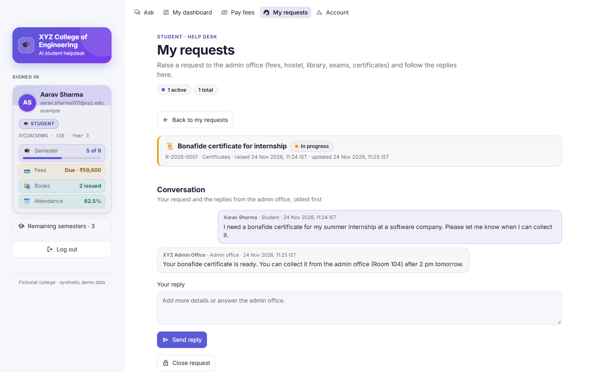 |

**Admin**

| Overview | Requests queue and conversation |
|---|---|
| 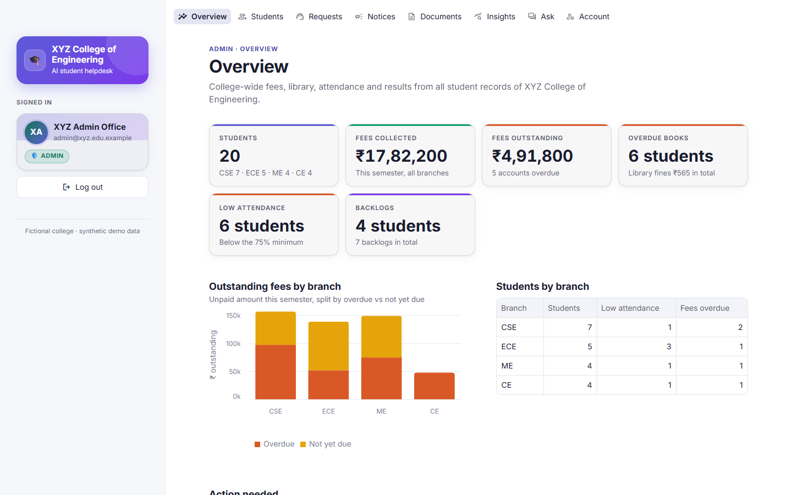 | 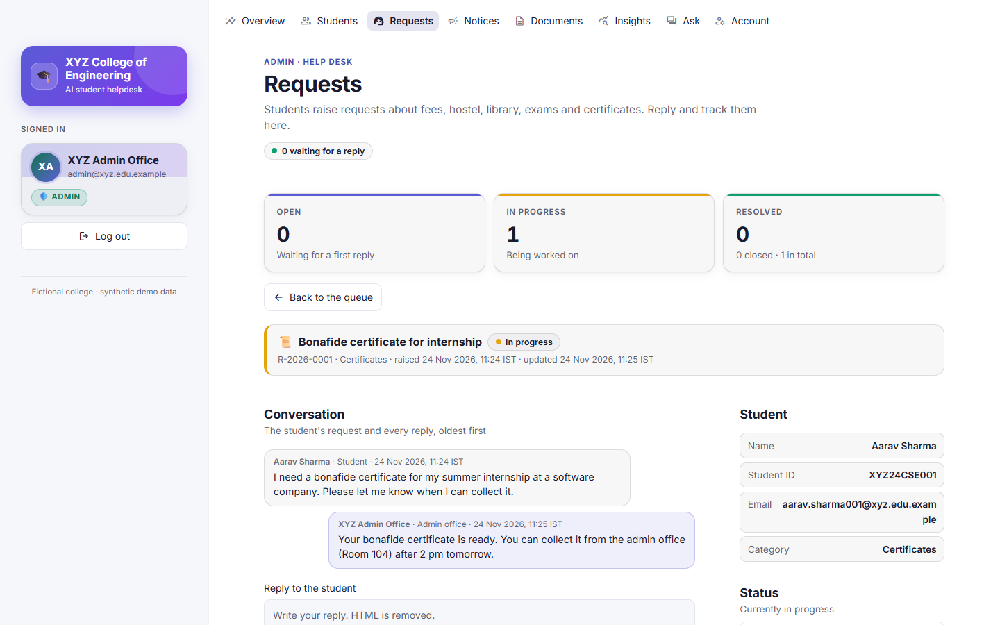 |

| Students → Manage record | Insights |
|---|---|
| 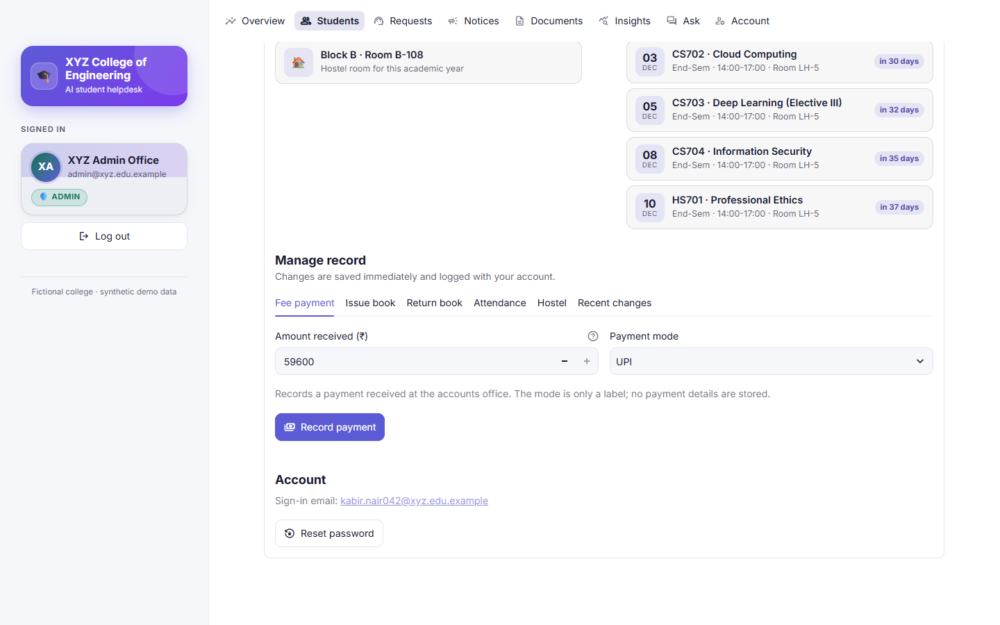 | 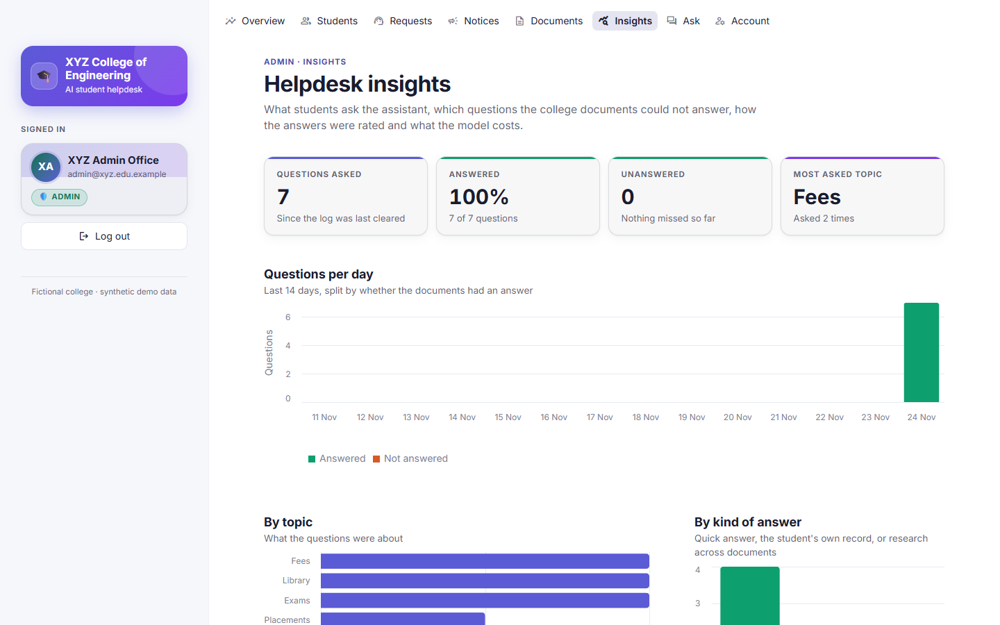 |

| Notices |
|---|
| 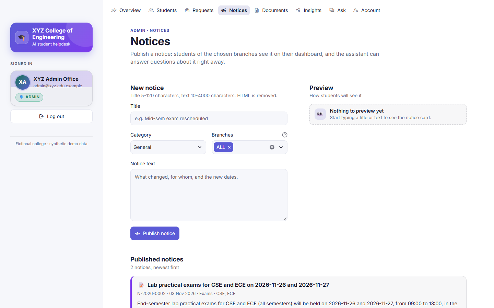 |

---

## 🏗️ Architecture

```mermaid
flowchart TB
    subgraph UI ["Streamlit app (app.py + ui/)"]
        LG["Sign in · Register · Reset"]
        ST["Student: Ask · My dashboard · Pay fees · My requests · Account"]
        AD["Admin: Overview · Students · Requests · Notices · Insights · Ask · Account"]
    end

    subgraph CORE ["Agent (src/smart_campus_assistant)"]
        G["graph.py · LangGraph"]
        R["router.py"]
        S["simple_rag.py"]
        P["personal.py"]
        D["deep_research.py"]
        G --> R --> S & P & D
    end

    subgraph DATA ["Data"]
        DOCS[("data/college/*.md")]
        NOT[("data/notices.json")]
        STU[("data/students.json")]
        DB[("SQLite app.db<br/>accounts · sessions · reset and sign-up codes<br/>requests · record changes · email outbox<br/>question log · answer ratings · model usage")]
        UP[("data/uploads/<br/>admin documents")]
    end

    subgraph LIVE ["Live mode (AWS)"]
        BR["Bedrock: Nova Micro / Nova Lite"]
        VEC[("S3 Vectors + Titan embeddings")]
    end

    subgraph DEMO ["Demo mode (offline)"]
        FK["fakes.py · extractive model"]
        LS["local_search.py · BM25"]
    end

    LG --> DB
    AD -- "replies · notices · fee reminders" --> OUT["notifications.py<br/>outbox → SMTP"]
    OUT --> DB
    ST & AD --> G
    ST & AD -- "requests · payments · record edits" --> DB
    G -- "question log (no identity)" --> DB
    AD --> NOT
    P --> STU
    S & P & D --> VEC
    R & S & P & D --> BR
    AD -- Documents page --> UP
    DOCS & NOT & UP -- ingest.py --> VEC
    DOCS & NOT & UP --> LS
    S & P & D -. demo .-> LS
    R & S & P & D -. demo .-> FK
```

**Two interchangeable backends.** In live mode every search goes to Amazon S3 Vectors and every model call to Bedrock. In demo mode `fakes.enable_fake_mode()` swaps both for offline versions that read the *same* documents, so the UI, the graph and the tests run unchanged without credentials. Demo mode is automatic when no AWS credentials are found, or forced with `SCA_DEMO_MODE=1`.

## 🧠 How a question is answered

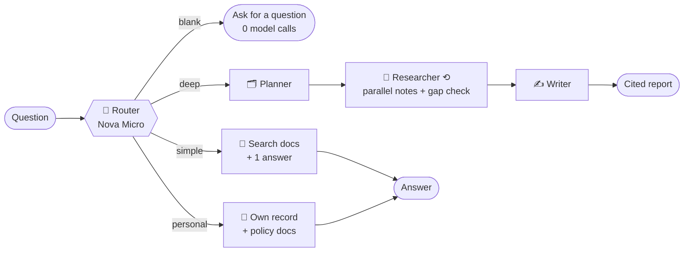

| Route | When | LLM calls |
|---|---|---|
| `simple` | One fact about the college ("What is the library fine per day?") | 2 |
| `personal` | The student's own data ("Meri fees ka status kya hai?") | 2 (1 for admins, who have no record) |
| `deep` | Comparisons and planning ("Compare CSE and ECE placements") | ~10 |

Details worth knowing:

- **Follow-up questions.** With the last 3 turns of the chat, the router first rewrites a follow-up ("aur ECE ka?") into a standalone question on Nova Micro, and the page shows it as "Understood as". Only questions that look like follow-ups pay for this call; who the question is about is never changed, so the privacy check still sees "my friend's fees".
- **Bounded cost.** Questions are trimmed to 2,000 characters, blank ones are answered without a model call, and the deep path is capped at 6 sub-questions and 2 extra research loops. Each account also has a question budget: 40 units per sliding hour (`SCA_CHAT_UNITS_PER_HOUR`), where a simple or personal answer costs 1 and a deep report 4, so one account cannot run up the model bill.
- **Money and dates are computed in code.** Late fees, library fines and "days left" are worked out by `student_data.py`, and fee totals (per semester, per year, first year with the deposit, four years, after scholarships) by `fee_calculator.py`. They reach the model as a labelled, citable block, so it copies numbers instead of adding them up.
- **Hybrid retrieval.** In live mode S3 Vectors and BM25 results are fused with reciprocal rank fusion, then reranked by query-word and heading overlap and branch match, with near-duplicates dropped (`ranking.py`, `SEARCH_MODE=hybrid`). Demo mode uses BM25 with the same rerank. Chunks follow the document headings, and citations carry the section.
- **Grounding check.** `grounding.py` drops `[n]` numbers that point at no source, keeps only the sources an answer cites (numbered in order), and replaces an answer with no valid citation and no record fact by one standard "Information not available" message.
- **Privacy check before the model.** `personal.py` refuses questions that name another student (ID, name, "my friend's fees"). Pronouns that usually mean a *thing* ("the hostel rules and their fees", "exam kab hai aur uski fees") are not mistaken for a person.
- **Parallel research.** The sub-questions of one loop run on `RESEARCH_WORKERS` threads and are merged back in plan order, so the report is the same as a sequential run.
- Every LLM call records tokens, latency and USD cost for the developer evaluation below. Neither students nor admins see these numbers in the app.

## 🔐 Accounts and security

- **Register:** a *new admission* signs up with any email, picks a branch and category, and gets a new Student ID with a first-year record. An *existing student* claims their account with their Student ID and college email. Either way a 6-digit code goes to the email first and the account is created only when it comes back (15-minute expiry, 5 attempts), because a Student ID and a college email are easy to find out. Online sign-up of new admissions can be switched off with `SCA_SELF_REGISTRATION=0`; claiming always works.
- **Passwords:** PBKDF2-HMAC-SHA256 (600k iterations, per-user salt), stored in SQLite (`data/app.db`, git-ignored). Rules: at least 8 characters, with a letter and a digit.
- **Login protection:** a generic "invalid email or password" message, timing-safe checks for unknown emails, and a 60 s lockout after 5 failures.
- **Sessions:** a random token in a `SameSite=Strict` cookie. Only its hash is stored on the server. It expires after 12 h, and logging out or changing the password revokes it.
- **Forgot password:** a 6-digit code with a 15-minute expiry and at most 5 attempts. It is sent by email when SMTP is configured. Only in **demo mode** (synthetic data, no SMTP) is the code shown on screen; in live mode without SMTP no code is ever issued (anyone could otherwise reset any account, the admin's included), so online sign-up is off and the admin office resets passwords.
- **Privacy:** only the signed-in student's record ever reaches a prompt.
- **Text input:** HTML tags are stripped from notices, requests and record fields, and every value is escaped when shown. Comparison signs keep their meaning (`attendance < 75%` is stored as `attendance ＜ 75%`).
- **Times:** stored in UTC, shown and counted per day in the college's time zone (`SCA_TIMEZONE`, default Asia/Kolkata).

---

## 🧰 Tech stack

| Layer | Choice |
|---|---|
| Orchestration | LangGraph |
| LLMs | Amazon Nova Micro (router), Nova Lite (answers) on AWS Bedrock |
| Embeddings | Amazon Titan Text Embeddings v2 |
| Vector store | Amazon S3 Vectors via `langchain_aws.AmazonS3Vectors` |
| Offline search | BM25 over the same chunks (`local_search.py`), no dependencies |
| App | Streamlit (role-based pages, Altair charts) |
| Accounts | SQLite + standard-library crypto (no extra auth packages) |
| Email | SMTP with STARTTLS from the standard library, through an outbox table |
| Quality | pytest (866 offline tests), Ruff, GitHub Actions |

## 🚀 Quick start

```bash
python -m venv .venv
.venv\Scripts\activate             # macOS/Linux: source .venv/bin/activate
pip install -r requirements-dev.txt
pip install -e .
cp .env.example .env               # AWS region, models, optional SMTP
python -m smart_campus_assistant.auth seed-demo   # demo accounts → data/demo_credentials.csv
```

**Offline (no AWS, no cost):**
```bash
SCA_DEMO_MODE=1 streamlit run app.py
```
On Windows PowerShell: `$env:SCA_DEMO_MODE = "1"; streamlit run app.py`.

**With AWS:** create an S3 vector bucket (us-east-1) named as in `VECTOR_BUCKET_NAME`, enable Bedrock access for Nova Micro, Nova Lite and Titan Embeddings v2, then:
```bash
python -m smart_campus_assistant.ingest   # index docs, notices and uploads (--dry-run to just count)
streamlit run app.py
```
After upgrading from a version with the old 800-character chunks, run `python -m smart_campus_assistant.ingest --prune` once so S3 Vectors drops the chunks the heading-based chunking no longer makes.

> [!IMPORTANT]
> With AWS credentials the app runs in **live mode** (also when `SCA_DEMO_MODE` is not set). Live mode never shows one-time codes on screen, so set the `SMTP_*` variables too: without an email server, online sign-up and "Forgot password" are switched off and the admin office has to create accounts and reset passwords.

**Email notifications:** set the `SMTP_*` variables. Replies and notices are emailed right away, in the background. For fee reminders, run this once a day (cron or Windows Task Scheduler), or use **Send fee reminders now** on the admin Overview page:
```bash
python -m smart_campus_assistant.notifications fee-reminders               # as of each record's date
python -m smart_campus_assistant.notifications fee-reminders --date 2026-12-01
python -m smart_campus_assistant.notifications deliver                      # send or retry waiting emails
```
Reminders use the same "today" as the student dashboard: a record's `as_of` date when it has one (the synthetic `students.json` is pinned to 2026-11-03, so demo numbers never drift), otherwise the real date. A failed email is retried after 5 and 30 minutes; one interrupted mid-send is picked up again after 15 minutes, so in that rare case a student can get it twice.

> [!TIP]
> Demo sign-ins are listed in `data/demo_credentials.csv` (git-ignored). You can also register your own student account from the sign-in page; in demo mode the verification code is shown on the page.

### ☁️ Free public demo (Streamlit Community Cloud)

1. Fork or push this repo to GitHub.
2. On [share.streamlit.io](https://share.streamlit.io) choose the repo, branch `main`, main file `app.py` and Python 3.11.
3. In **Advanced settings → Secrets**, add:
   ```toml
   SCA_DEMO_MODE = "1"
   SCA_DEMO_PASSWORD = "campus-demo-2026"
   ```
   On first start the app creates every demo account with that password, which must be at least 8 characters and contain a letter and a digit. Pick your own: anyone who knows it can sign in to the demo.

> [!WARNING]
> The free host's disk is temporary. Registrations, sessions, chats and new notices reset when the app restarts.

## ⚙️ Configuration

Everything is set through environment variables (or `.env`); all have defaults except the AWS credentials.

| Variable | Default | Purpose |
|---|---|---|
| `AWS_ACCESS_KEY_ID`, `AWS_SECRET_ACCESS_KEY`, `AWS_DEFAULT_REGION` | – / – / `us-east-1` | Bedrock and S3 Vectors access (live mode) |
| `VECTOR_BUCKET_NAME`, `VECTOR_INDEX_NAME` | `smart-campus-assistant-vectors`, `xyz-college-docs` | S3 Vectors bucket and index |
| `ROUTER_MODEL_ID`, `ANSWER_MODEL_ID`, `EMBEDDING_MODEL_ID` | Nova Micro, Nova Lite, Titan v2 | Bedrock models |
| `RETRIEVER_K` | `5` | Chunks retrieved per search |
| `MAX_RESEARCH_LOOPS` | `2` | Extra gap-check loops on the deep path |
| `RESEARCH_WORKERS` | `4` | Sub-questions researched at once (`1` = sequential) |
| `SCA_DEMO_MODE` | auto | `1` forces offline demo mode, `0` forces live |
| `SCA_DEMO_PASSWORD` | – | Hosted demos: create all demo accounts with this password on first start |
| `SCA_DB_FILE`, `SCA_NOTICES_FILE`, `SCA_CHATS_DIR` | under `data/` | Storage locations |
| `SCA_QUESTION_LOG` | on | `0` turns off the anonymous Insights data: question log, answer ratings and model usage |
| `SEARCH_MODE` | `hybrid` | `hybrid` (vector + BM25, reranked) or `vector` (S3 Vectors only) |
| `SCA_UPLOADS_DIR` | `data/uploads` | Where documents uploaded on the Documents page are kept |
| `SMTP_HOST`, `SMTP_PORT`, `SMTP_USER`, `SMTP_PASSWORD`, `SMTP_FROM` | – | Email password reset codes and student notifications (otherwise reset codes are shown on screen in demo and notifications are only recorded) |
| `SCA_EMAIL_NOTIFICATIONS` | on | `0` turns student email notifications off |
| `SCA_SELF_REGISTRATION` | on | `0` turns off online sign-up of new admissions (existing students can still activate their account) |
| `SCA_CHAT_UNITS_PER_HOUR` | `40` | Question budget per account per hour (simple/personal = 1, deep = 4); `0` = no limit |
| `SCA_TIMEZONE` | `Asia/Kolkata` | Time zone for times shown to people and for "per day" counts |

## 🧪 Tests and model evaluation (developers)

The model evaluation is a development tool, so it is not part of the app. It compares the router with an "always deep" baseline on 45 labelled questions (`eval/questions.json`) and writes `eval/results/latest.csv` and `latest_summary.json`.

```bash
python eval/run_eval.py          # live: router vs always-deep (route accuracy, tokens, cost, latency)
python eval/run_eval.py --fake   # offline dry run (free, a few seconds)
python -m pytest -q              # 866 offline tests (fake LLM, offline search, temp SQLite)
ruff check .                     # lint
```

### Router evaluation results (live, 45 questions)

| Metric | Router | Always deep |
|---|---:|---:|
| Route accuracy | **97.8 %** | – |
| Total cost | **$0.0136** | $0.0343 |
| Avg latency | **7.4 s** | 18.4 s |
| Answer keyword hit | 0.87 | 0.89 |

**60 % cheaper and about 2.5× faster at the same answer quality.** Simple answers average about 2.9 s, personal answers about 2.8 s and deep reports about 18.6 s.

> [!NOTE]
> These numbers are from a live Bedrock run made before parallel research was added, so deep latency should now be somewhat lower; re-run `python eval/run_eval.py` to refresh them. An offline run (`--fake`) only checks the pipeline: its accuracy and latency describe the stand-in model, not Bedrock.

---

The tests cover routing, follow-up rewriting, the three answer paths, privacy refusals, late-fee and fine math, accounts and sessions, sign-up with email verification, password reset (including live mode without an email server), notices, support requests (including one student never seeing another's), record changes and their permissions, email notifications (outbox, retries, reminders), the question budget, the question log's privacy masking, time zones, hybrid search and chunking, document uploads, fee totals and the grounding check, answer ratings and model usage, every Streamlit page and its shared UI patterns, and edge cases such as blank or oversized questions, HTML in text and concurrent research. GitHub Actions runs the tests and Ruff on every push and pull request.

## 🗂️ Project layout

```
app.py                         sign-in gate + role-based navigation
ui/                            Streamlit pages
  login.py  account.py  session.py     sign in, register, reset, cookies
  chat.py                              "Ask" page
  student_home.py  student_payments.py student dashboard, pay fees
  student_requests.py                  student requests
  admin_overview.py  admin_students.py admin overview, students + manage record
  admin_requests.py  admin_notices.py  request queue, notices
  admin_documents.py                   document uploads
  admin_insights.py                    helpdesk insights, ratings, model usage
  components.py  theme.py              shared HTML builders and CSS
src/smart_campus_assistant/
  graph.py  router.py  state.py        LangGraph wiring, 3-way router, state
  simple_rag.py  personal.py           simple and personal paths
  deep_research.py  prompts.py         planner → researcher → writer
  retriever.py  ingest.py              hybrid search and heading-based indexing
  ranking.py  documents.py             rank fusion + rerank, admin document uploads
  grounding.py  fee_calculator.py      citation check and not-found message, fee totals in code
  local_search.py  fakes.py            offline BM25 search and stand-in model
  config.py                            settings, demo/live mode, time zone
  auth.py  db.py  mailer.py            accounts, sessions, reset and sign-up codes (SQLite), SMTP
  student_data.py  notices.py          student records, admin notices
  record_updates.py                    audited record changes and payments
  support_requests.py                  student requests and replies
  question_log.py                      anonymous question log for Insights
  feedback.py  run_metrics.py          answer ratings, model usage and failures
  notifications.py                     student emails: outbox, fee reminders, delivery
  followup.py                          follow-up questions rewritten into standalone ones
  rate_limit.py                        per-account question budget for the chat
  chat_store.py  usage.py              chat history, token and cost tracking (eval)
eval/                          45 labelled questions + runner (developers only)
data/college/                  synthetic college documents (see data/sources.md)
docs/screenshots/              images used in this README
tests/                         offline tests
.github/workflows/ci.yml       tests + lint on every push
```

## 🛣️ Roadmap

- [x] Follow-up questions that use the earlier turns of the chat
- [x] Email students when the admin replies to a request, publishes a notice, or a fee is due
- [ ] A real payment gateway (sandbox) behind the Pay fees page
- [x] Compute totals (fees, yearly cost) in code instead of in the LLM
- [x] Heading-level chunking for long rules (e.g. degree classification)
- [x] Email verification on registration
- [ ] Persistent storage (Postgres) for the hosted demo

<div align="center">

Built with LangGraph · AWS Bedrock · Amazon S3 Vectors · Streamlit

</div>
